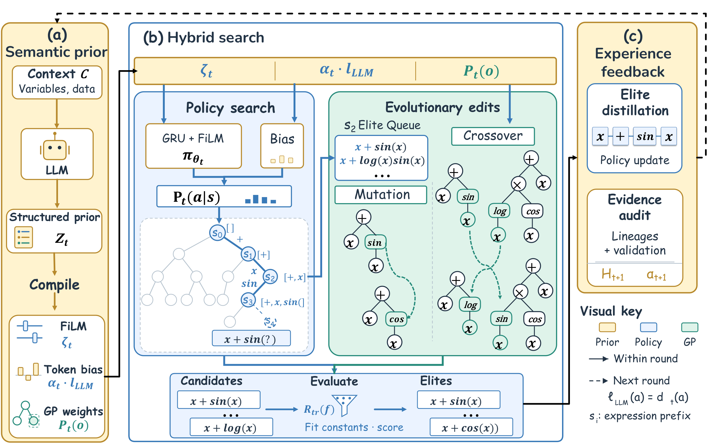

<p align="center">
  
</p>

# SAGE-SR

Code for **Search-Adaptive Semantic Guidance with Evidence Feedback for Symbolic Regression**.

## Framework

The framework connects multilevel semantic guidance, MCTS–GP search, and
evidence-driven adaptation across search rounds.

<p align="center">
  
</p>

[View the framework as a vector PDF](assets/framework.pdf).

## Installation

Use Python 3.10 or later and a C++20 compiler. On Windows, run from a Visual
Studio developer terminal. Eigen 3.4 and pybind11 are discovered locally or
downloaded by CMake when unavailable.

```bash
python -m pip install .
```

The native extension is built as `sage_sr._core`. OpenMP is disabled by default
so the backend can be used alongside PyTorch without loading a second OpenMP
runtime. See [implementation details](docs/implementation.md) for configuration.

## Run with an LLM

Configure an OpenAI-compatible chat-completions endpoint serving the desired
backbone. Qwen3-4B is the default experimental backbone; the same interface can
serve Llama-3.1-8B. Set the model identifier to the name exposed by your server.

```bash
export SAGE_SR_LLM_BASE_URL=http://localhost:8000/v1
export SAGE_SR_LLM_MODEL=Qwen3-4B-Instruct
export SAGE_SR_LLM_API_KEY=your_key_if_required
sage-sr train.csv --target y --config configs/paper.json --output results/run.json
```

Use the corresponding `$env:NAME="value"` assignments in PowerShell. No `.env`
file is loaded automatically. Provide task semantics as a JSON object using
`--context task.json`; input statistics are computed only from the search-training
split. Training and validation constants are shared; test data is used only after
discovery.

CSV input must have a header and numeric values. NPZ input accepts `X/y` or
`X_train/y_train`, optional `feature_names`, and optional `X_test_id/y_test_id`
and `X_test_ood/y_test_ood`. Input matrices use `(samples, features)` layout.
Datasets are not included in this repository.

## Python API

```python
from sage_sr import LLMController, SAGESRRegressor, SearchConfig

model = SAGESRRegressor(SearchConfig(), LLMController())
model.fit(X, y, feature_names=["position", "velocity"],
          context={"target": "acceleration", "description": "A nonlinear oscillator"})
predictions = model.predict(X_test)
model.save("results/oscillator.json")
```

## Offline integration example

The following example uses a fixed, explicit prior to check the search and
feedback pipeline without an LLM request. It is an engineering check, not a
benchmark result or an alternative backbone.

```bash
python examples/make_example.py data/example.npz
sage-sr data/example.npz --config configs/smoke.json --controller static \
  --prior configs/example_prior.json --output results/example.json
```

## Components and evaluation

`--ablation` supports `no-token-bias`, `no-film`, `uniform-mutations`,
`static-prior`, `fixed-trust`, `no-elite-inheritance`, and
`no-evolutionary-edits`. Each changes the named component of the full model.
The static-prior ablation fixes semantic content while retaining policy updates
and trust calibration; disabling FiLM preserves the learned GRU policy.

The default budget is four rounds of 25,000 candidate evaluations. The search
reward is `eta**nodes / (1 + RMSE)`, with `eta=0.99`. Reported test metrics trim
at the 95th relative-error percentile and normalize MSE using the retained
targets' variance. Task success requires a maximum retained relative error of
at most 0.01. Exact definitions and numerical guards are documented in
[the implementation guide](docs/implementation.md).

```bash
python -m pip install -e '.[test]'
python -m pytest
```

## License and acknowledgments

SAGE-SR is released under the MIT License; see [LICENSE](https://github.com/Kaoney-l/SAGE-SR/blob/main/LICENSE). Third-party dependencies and their applicable licenses are documented in [THIRD_PARTY_NOTICES.md](https://github.com/Kaoney-l/SAGE-SR/blob/main/THIRD_PARTY_NOTICES.md) and `third_party/licenses/`. External benchmark datasets remain subject to their respective access and license terms.
